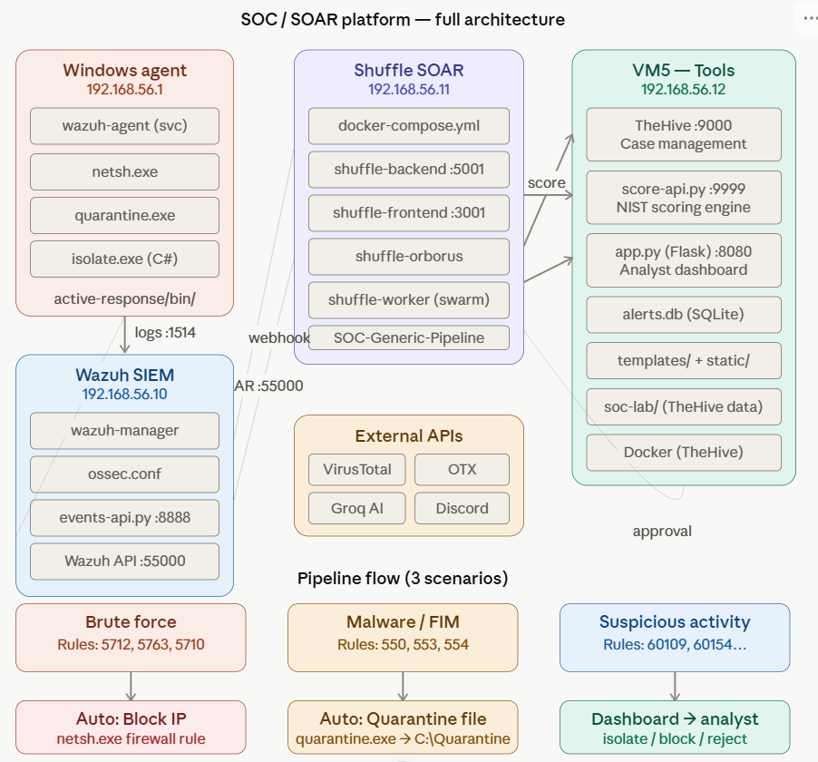
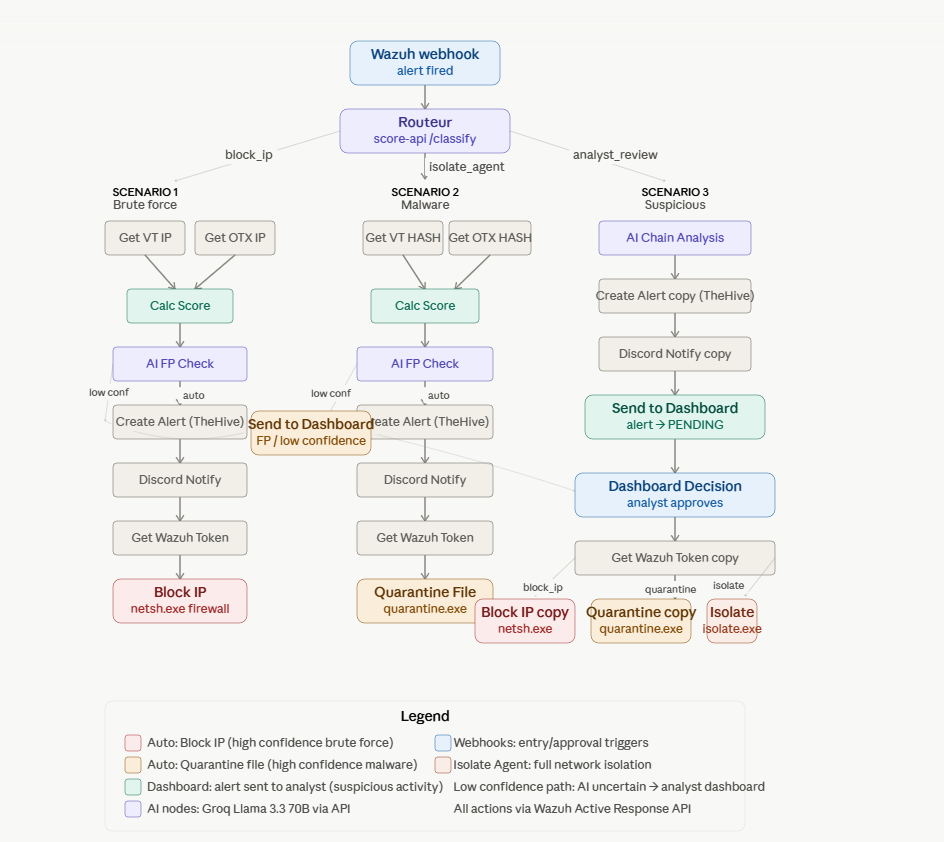
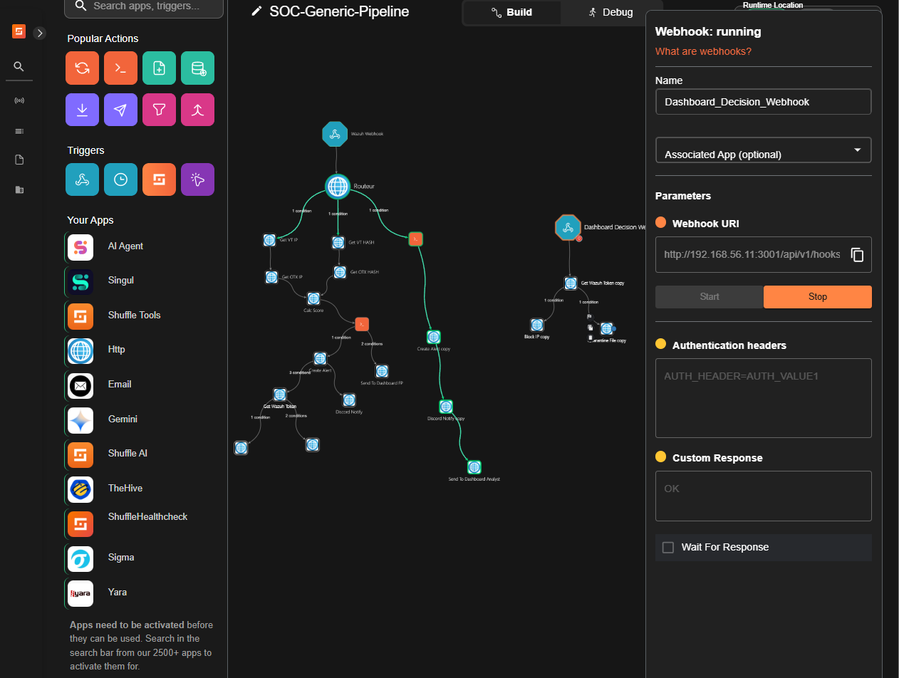
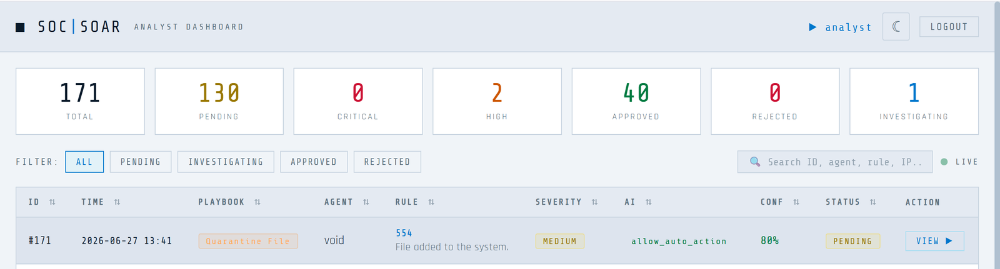
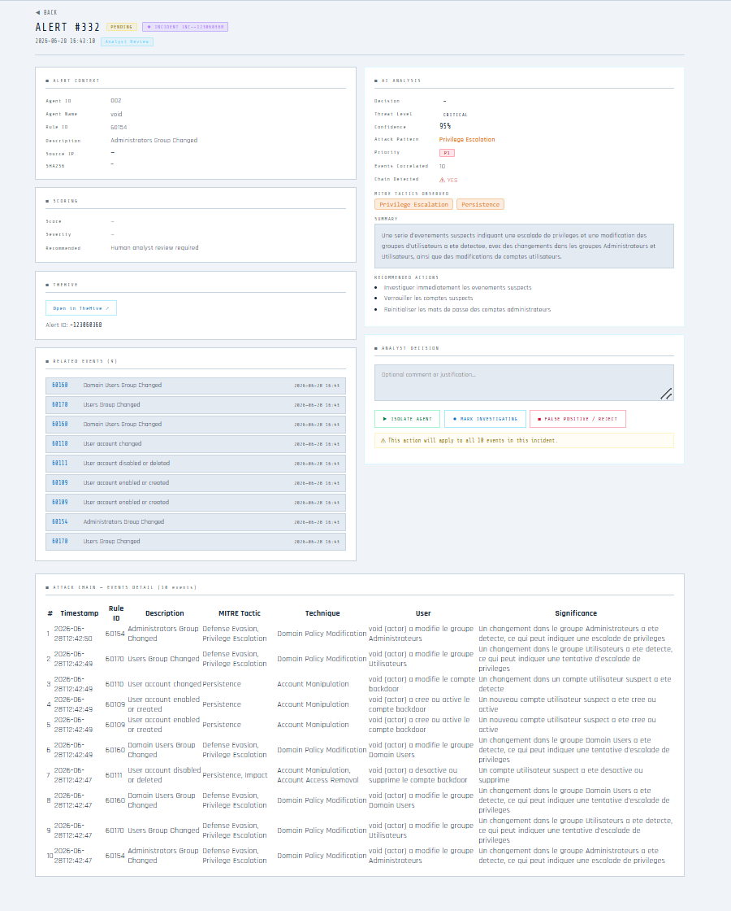
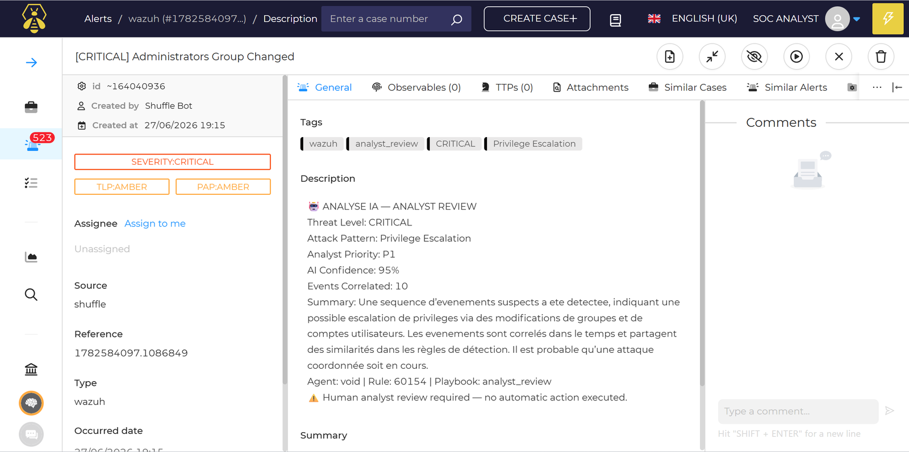
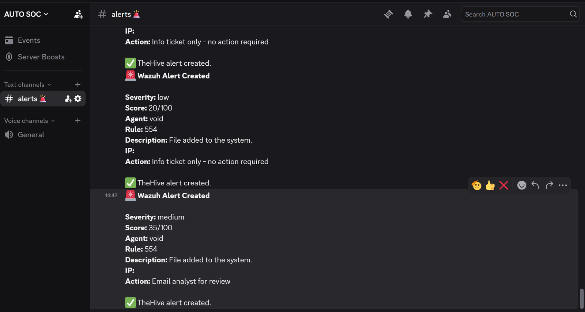

# Auto SOC — Automated SOC / SOAR Platform

A lab SOC that detects, enriches, scores and responds to security alerts automatically, and hands the uncertain ones to a human analyst.

**Wazuh** detects → **Shuffle** orchestrates → a custom **Score API** scores the alert (NIST-inspired, 0–100) using **VirusTotal** and **OTX** → an **LLM (Groq, Llama 3.3 70B)** decides whether automatic action is safe → **TheHive** and **Discord** are notified → the endpoint is protected through **Wazuh Active Response**, or a **Flask analyst dashboard** asks a human to decide.

> Lab project built to demonstrate the concept. It is not production software.



## How it works

Every Wazuh alert is classified by rule ID into one of three scenarios:

| Scenario | Typical trigger | What happens |
|---|---|---|
| **Block IP** | SSH / authentication brute force | Enrich the IP (VirusTotal, OTX) → score → AI false-positive check → TheHive alert → **block the IP** in the Windows firewall |
| **Quarantine file** | Malware / file-integrity events | Enrich the file hash → score → AI false-positive check → TheHive alert → **move the file to quarantine** |
| **Analyst review** | Suspicious activity (new admin account, group changes...) | AI correlates the recent events into an attack chain → TheHive alert → **dashboard**, no automatic action |

When the AI is not confident enough, or the behaviour is only suspicious, the alert waits on the dashboard. The analyst approves a block, a quarantine or a host isolation, or rejects it as a false positive, and Shuffle executes the decision.



## Highlights

- **Human in the loop by design:** automation only runs when the AI is confident and the alert is not a likely false positive. If the AI is unavailable, it fails safe and sends the alert to the analyst.
- **Explainable scoring:** five equal criteria (Wazuh level, VirusTotal, OTX, MITRE tactic, frequency) plus a bonus, with a full evidence report attached to every TheHive alert.
- **AI attack-chain analysis:** correlates the last suspicious events of an endpoint and explains them in a short summary with MITRE tactics.
- **Incident grouping:** related analyst-review alerts are merged into one incident on the dashboard.
- **Everything is orchestrated in Shuffle:** all response actions go through the Wazuh Active Response API.

## Screenshots

**Shuffle workflow**


**Analyst dashboard**


**Incident detail with AI attack-chain analysis**



**TheHive alert created by Shuffle**


**Discord notifications**


## Stack

Wazuh 4.14.4 · Shuffle (SOAR) · TheHive 5 + Cortex · Python (Score API, Events API, active-response scripts) · Flask + SQLite (dashboard) · VirusTotal · OTX AlienVault · Groq (Llama 3.3 70B) · Discord · Docker

## Academic project

This platform is the end-of-year project (*projet de fin d'année*, 2025–2026) of the **Network Engineering and Information Security** track at **ENIAD** — École Nationale de l'Intelligence Artificielle et du Digital, Berkane (Université Mohammed Premier, Oujda, Morocco).

**Authors:** AIT MBAREK Karim · Idchaoudi Youssef · TAHRI Mohammed
**Supervisors:** Pr. Manale Boughanja (academic) · Ms. Zineb Bakraouy (co-supervisor)

The full academic report (80 pages, French) is included as [`rapport_academique.pdf`](rapport_academique.pdf).

## Repository

```text
1-windows-agent/             Windows endpoint: quarantine active-response script
2-wazuh-manager/             Wazuh server: Events API
3-shuffle-soar/              Shuffle workflow + the two AI nodes
4-score-api-and-dashboard/   SOC server: Score API, analyst dashboard, TheHive/Cortex compose file
  legacy-decision-api/       Early prototype, superseded by the Flask dashboard (kept for reference)
docs/                        Screenshots and diagrams
```

## Deploy it

**Read [`DEPLOY.md`](DEPLOY.md).** It explains the installation step by step, which files you must configure, and the parts that are not in this repository and that you must create yourself.

## Using an AI assistant?

Give your assistant [`everythingunee2know-giveittoai.md`](everythingunee2know-giveittoai.md). It contains the complete context of the project (architecture, every component, payloads, thresholds, known issues and how to recreate the missing files), so it can guide you through the deployment and help you rebuild what the repository does not include.

> No secrets are stored in this repository. Every key is a placeholder such as `<GROQ_API_KEY>`. Use your own keys and never commit them.
